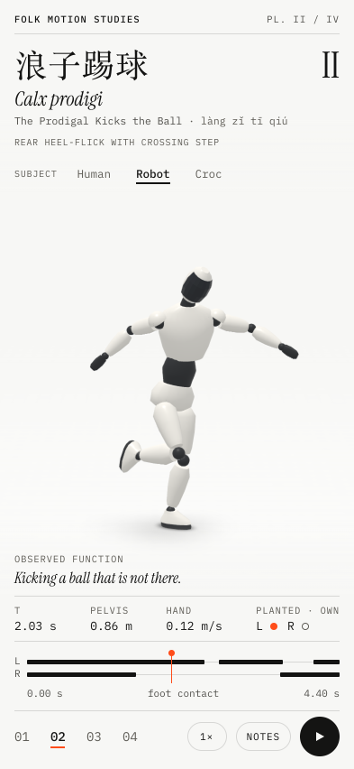
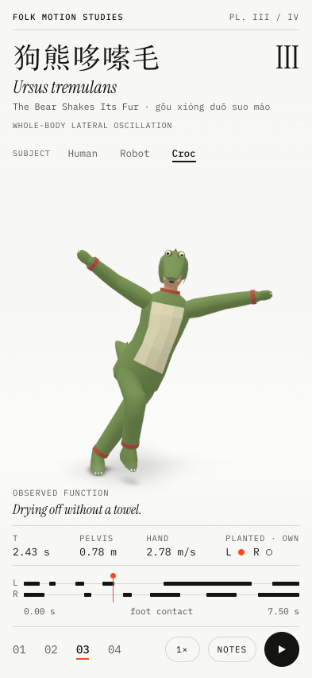
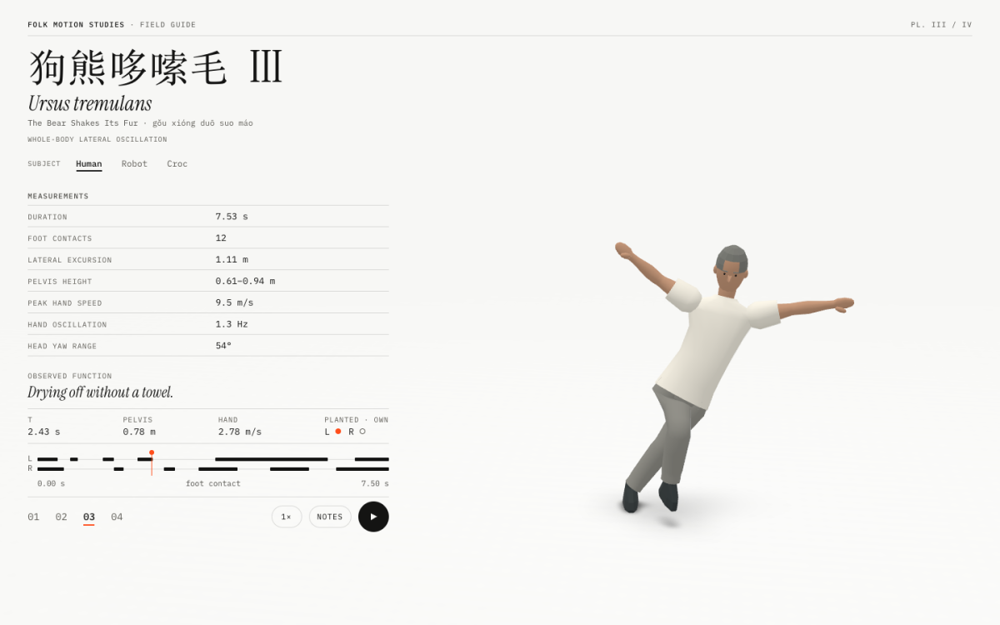

# Folk Motion Studies

A deadpan field guide to four movements of Chinese folk dance, reconstructed in 3D
from a single teaching video and presented like zoological specimens: pseudo-Latin
binomials, measured telemetry, and an "observed function" for each move.

| | | |
|---|---|---|
|  |  |  |

| Plate | Move | Binomial | Observed function |
|---|---|---|---|
| I | 闪身步 *shǎn shēn bù* — The Flash Step | *Gressus fulgurans* | Evading something no one else can see. |
| II | 浪子踢球 *làng zǐ tī qiú* — The Prodigal Kicks the Ball | *Calx prodigi* | Kicking a ball that is not there. |
| III | 狗熊哆嗦毛 *gǒu xióng duō suo máo* — The Bear Shakes Its Fur | *Ursus tremulans* | Drying off without a towel. |
| IV | 摇头晃脑 *yáo tóu huàng nǎo* — Shaking the Head | *Caput oscillans* | Broadcasting complete satisfaction with oneself. |

Every move can be performed by three subjects on the same rig: a **Human** (the
original low-poly instructor), a **Robot** (a sleek generic humanoid, no brand marks)
and a **Croc** (a man in a crocodile onesie).

Built with [IWSDK](https://iwsdk.dev) (WebXR on Three.js). Phone-first in the browser;
a headset session offers the original guided lesson with hand coaching.

## Run

```sh
npm install
npm run dev        # IWSDK-managed dev server + browser; prints HTTPS desktop/headset URLs
npm run build      # production build in dist/
npm test           # motion, contact, lesson and coaching tests
```

## How to play

A field trial. The specimen stands at rest (specimen 0, *Status expectans*); tap a throwable in
the tray and it is thrown at him from the button you pressed. He responds with a recorded move,
and its observed function becomes literally true:

| Throw | Response | Observed function |
|---|---|---|
| Soda can | 闪身步, ducks aside at the last instant | Evading something no one else can see. |
| Shuttlecock (毽子) | 浪子踢球, kicks it back up with the raised foot | Kicking a ball that is not there. |
| Water balloon | gets soaked, then 狗熊哆嗦毛 | Drying off without a towel. |
| Red paper flower (小红花) | pinned to his chest, then 摇头晃脑 | Broadcasting complete satisfaction with oneself. |

Three clean dodges or returns in a row earn an unprompted gloat. The trial log counts Dodged /
Returned / Soaked / Flattered. After a dodge he steps back to his mark; every other response
finishes on it too. Swipe left/right on the stage (or tap the masthead tabs) to change subject;
the camera is fixed. **Notes** opens the specimen card; **Save plate** renders this moment as a 3:4 field-guide
plate (1080×1440) to share or download (`src/plate.ts`). Keys: 1–4 throw, Space throws at random, ←/→ subject,
N notes. The interface is in Chinese for Chinese-language browsers and English otherwise;
`?lang=zh` or `?lang=en` overrides it. `?avatar=instructor|robot|croc` picks the subject, and old
plate links (`?specimen=3&t=3.4`) still open that plate as recorded.

Each throw is choreographed to its recording: the flight is timed and aimed (from the posed rig)
so the thing arrives on the clip's key frame. Clips cross-fade and play relative to where he
stands (`src/specimen-viewer.ts`); the props, splash and pinned flowers live in `src/trial.ts`
(`src/scene-assets/props.scene-asset.ts` for the models); sound is synthesised (`src/sfx.ts`).

## How it looks the way it does

- **White studio:** an unlit paper floor with a soft light pool, fog and background in the
  same tone (no horizon), a key, fill and cool rim light.
- **Contact shadows:** the subject is rendered from below into small targets (a wide
  ambient layer and a tight contact layer), blurred and laid on the floor; dither-free,
  dark where soles touch, fading as limbs rise (`src/contact-shadow.ts`).
- **HUD:** DOM overlay (`src/hud.ts`, `src/hud.css`) in IBM Plex Mono and Instrument Serif.
  The camera measures the free band the HUD leaves and fits a common specimen height into
  it on every screen size (`src/specimen-viewer.ts`).
- **Measurements** in the notes are computed from the motion (`src/motion-stats.ts`).
- **Mobile:** pixel ratio capped at 2, the ambient shadow refreshes every other frame,
  44 px tap targets, layouts checked at 393×852 and 360×740.

## Motion reconstruction

Source: [teaching-footage compilation](https://www.bilibili.com/video/BV1YMaA6jEpK/),
uploaded by 月咏卡农. Demonstrators: 赵铁春 (plates I–II, Anhui Flower-Drum Lantern) and
明文军 (plates III–IV, Shandong Drum Yangge). The video is a local processing input only and
is excluded from the repository and build; no permission to redistribute footage is asserted.

```sh
python3.13 -m venv .venv-pose && .venv-pose/bin/pip install -r scripts/requirements-pose.txt
mkdir -p .local/media .local/models
.venv-pose/bin/yt-dlp -f 'bestvideo[height<=720]+bestaudio/best' --merge-output-format mp4 \
  -o '.local/media/reference.%(ext)s' 'https://www.bilibili.com/video/BV1YMaA6jEpK/'
curl -L -o .local/models/pose_landmarker_heavy.task https://storage.googleapis.com/mediapipe-models/pose_landmarker/pose_landmarker_heavy/float16/1/pose_landmarker_heavy.task
curl -L -o .local/models/pose_landmarker_full.task https://storage.googleapis.com/mediapipe-models/pose_landmarker/pose_landmarker_full/float16/1/pose_landmarker_full.task
.venv-pose/bin/python scripts/pose_raw.py .local/media/reference.mp4 --model heavy
.venv-pose/bin/python scripts/pose_raw.py .local/media/reference.mp4 --model full
.venv-pose/bin/python scripts/camera_track.py .local/media/reference.mp4
.venv-pose/bin/python scripts/pose_solve.py          # writes public/motion/*.json
```

Shot boundaries and move windows live in `scripts/motion-clips.json`.

1. **Raw** (`pose_raw.py`): MediaPipe Pose Heavy and Full on every 30 fps frame, each also
   on a mirrored copy; fresh trackers per camera shot.
2. **Camera** (`camera_track.py`): the stage camera pans up to ~140 px to follow the dancer;
   median dense optical flow over the masked backdrop maps landmarks into stage coordinates.
3. **Solve** (`pose_solve.py`): four-way ensemble; outlier rejection and zero-phase
   low-pass per shot; bone directions from image-plane angles plus model depth with camera
   tilt removed; hinge-aware retarget to the 17-bone rig (elbows and knees flex one way,
   twist relaxes to anatomical and is clamped to joint limits); head fitted from a generic
   3D face to the 2D face landmarks; contacts detected from the footage, each pinned to one
   floor anchor with exact leg IK; swing feet clear the floor; legs kept from passing
   through each other; close-ups (legs unseen) bridged with held or synthesized steps.
4. **Review**: `pose_review.py` (rig front/side vs footage), `render-review.mjs` +
   `pose_delta.py` (footage vs the rendered character, with an error graph).

Depth comes from one camera and is approximate; legs in close-up shots are inferred and
flagged in each motion file's `estimated` ranges. This is an estimated guide, not motion
capture, and not a substitute for an instructor.

## Characters

All three share the instructor rig (`src/scene-assets/instructor-proportions.ts`), so any
motion plays on any subject. Sources are deterministic Three.js modules in
`src/scene-assets/` (`instructor`, `robot`, `croc`, with `avatar-kit.ts` for shared
construction); GLBs in `public/characters/` are exported from them with the dev server
running:

```sh
AVATAR=robot npx @iwsdk/cli browser run scripts/export-instructor.mjs   # instructor | robot | croc
python3 scripts/pack-instructor-glb.py robot
```

Promo video (3:4, 1080×1440, for Xiaohongshu): frame-exact capture of the shots in
`scripts/promo/shots.json`, an original synthesised soundtrack, and Chinese captions.

```sh
npm run build && npx vite preview --port 4173 &
node scripts/promo/capture.mjs .local/promo/frames
.venv-pose/bin/python scripts/promo/music.py .local/promo/music.wav 32 "8,9,10,11" "2,12,16,20,24,28"
.venv-pose/bin/python scripts/promo/compose.py .local/promo/frames .local/promo/music.wav .local/promo/folk-motion-xhs.mp4
```

Design review tooling (headless Chromium, production build served by `vite preview`):
`scripts/phone-shots.mjs`, `scripts/avatar-shots.mjs` with `review-sheet.py` /
`avatar-sheet.py`.

## Headset lesson

In an immersive session the original guided lesson returns: three shapes per move, a
count-in, and optional hand coaching that compares tracked wrists to the guide in the
front plane. It never assesses legs, balance or technique. Start slowly with small
movements in clear space.

## License

The code is released under the [MIT License](LICENSE). The motion files in
`public/motion/` are derived from third-party teaching footage (see
[Motion reconstruction](#motion-reconstruction)) and are not covered by that license.
